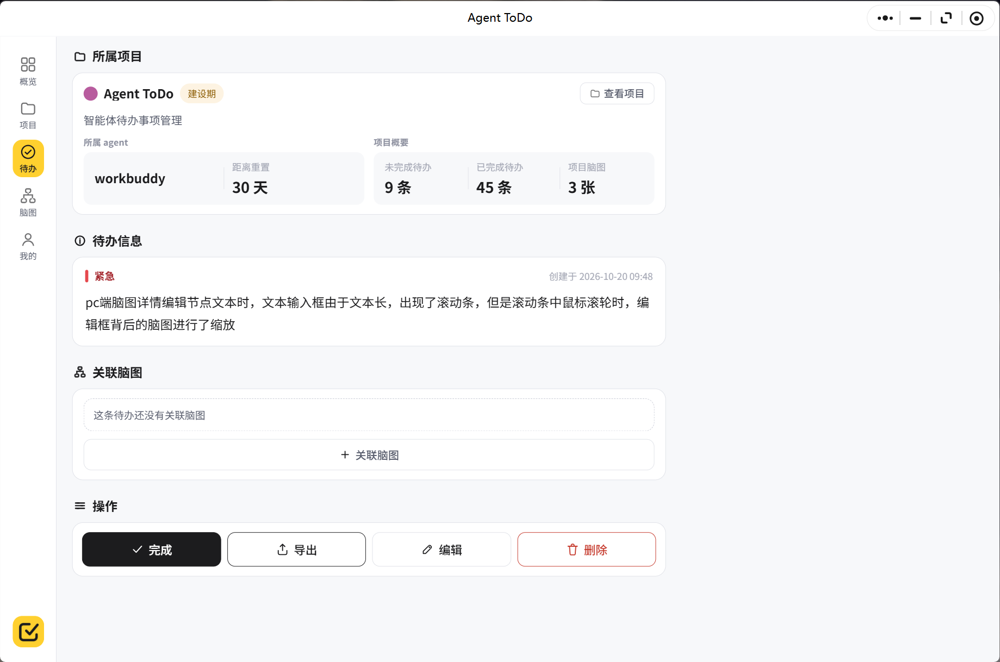
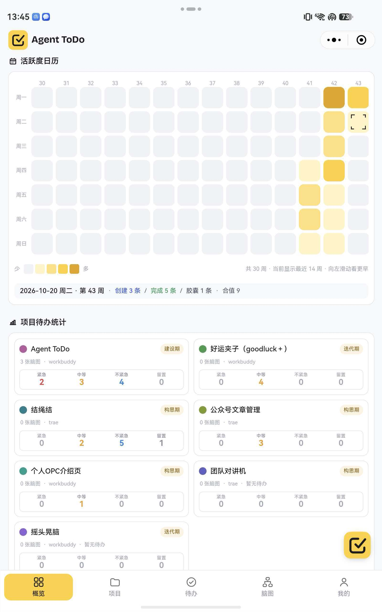
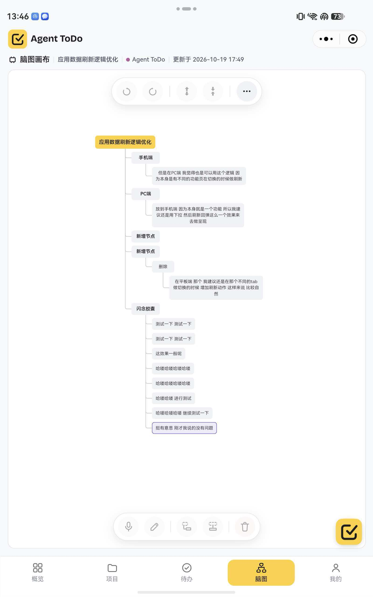

# Agent-ToDo · DSH 插件

> 把散落的现场输入整理成能直接交给 Agent 的任务规格，在 DeepSeek Harness 里完成交接

[](LICENSE)

这是为 FDE（Forward Deployed Engineer，前沿部署工程师）设计的多项目工作台 **Agent-ToDo** 的 DeepSeek Harness 插件。装好后，DSH 里多一个与小程序同源的五模块工作台：现场记下的话收进闪念胶囊，归到项目、拆成脑图，最后连上下文一起导出给 Agent。

社区插件，非 DeepSeek 官方出品，与 DeepSeek AI 无隶属关系。

## 安装

需要 DeepSeek Harness 的 Web profile，以及 Node.js 22.19+ 或 24+。

```bash
dsh plugin --profile web add github:329604421/agent-todo-plugin
```

安装完成后重启 `dsh web`。入口有三处：侧栏的 **Agent ToDo** 图标、输入框左侧的 **Agent ToDo** 按钮（未完成待办导出器）、全局快捷键 `Alt+Space`（快速捕获）。

分类：工作流与自动化。许可证：MIT。

## 登录与数据

**未登录是完整可用的演示态**：本地会话数据，不写库、不发请求、不调用模型，界面上会有明确的「演示数据」提示。

要连真实数据，用小程序里的一次性登录验证码：

1. 打开 Agent-ToDo 微信小程序 → **我的** → **DeepSeek Harness 登录**
2. 点「生成验证码」，得到 6 位数字（10 分钟有效、一次性、最多 5 次尝试）
3. 在插件的登录弹窗里粘贴，换取 365 天有效的设备凭证

设备凭证只写在本机 `~/.dsh/agent-todo/auth.json`（best effort 0600），由插件 Host 半的代理使用，不写日志、不进前端状态之外的地方，随时可「退出登录」清除。

⚠️ **数据去向**：默认后端是作者托管的正式服务 `https://todo.memorymap.cn/api/v1`，登录后所有读写都发生在那里。想接自己的后端，在 profile 的 bundle 配置里给 `agent-todo` 条目设置 `config.apiBase`（见 `cordis.patch.yml` 的 `config` 段），插件 Host 会把 `/agent-todo/api/*` 转发到该地址。请勿把生产凭证提交到任何仓库。

## 能做什么

| 模块 | 内容 |
| --- | --- |
| 概览 | 30 周活跃度日历、项目待办统计、Agent 概况 |
| 项目 | 页内列表 + 详情三块，归档而不删除，四档紧急度汇总 |
| 待办 | 页内列表 + 筛选浮层 + 详情六区块；正文、图片、脑图、关联胶囊一起导出为 Markdown Handoff |
| 脑图 | 六种格式、拖拽改父子、撤销重做、缩放平移、节点语音改字、导出 Markdown |
| 我的 | 个人资料、Agent 概况、Token API、应用提示 |
| 闪念胶囊 | DSH 全局浮层，语音 / 文字 / 图片记录，单条或多条转待办、转脑图，多选整理 |

原生触点还包括：助手消息里的「闪念」动作、输入框里的待办导出与「增强导出」、以及供 Agent 调用的 `agent_todo` 工具（18 个 action）。样式跟随 DSH 主题令牌，浅色 / 深色都可用，不引入 iframe、不复刻小程序 runtime、不打包第二份 React。

## 界面

下图是 Agent-ToDo 产品界面；DSH 插件在宿主内复用同一套组件规范与设计令牌，呈现为三栏工作台（导航 / 列表 / 详情）。







## 权限与外部服务

| 类别 | 说明 |
| --- | --- |
| 网络 | 仅访问 `apiBase` 下的 `/api/v1/*`；未登录时零请求，所有写操作都在用户输入或点击后发生 |
| 麦克风 | 语音胶囊用 `getUserMedia` + `MediaRecorder` 采集，重采样为 16 kHz / 单声道 / PCM16 WAV；优先走 DSH 自带的 `ctx.remote.speech`，未就绪才降级到后端 `POST /asr` |
| 本机文件 | 只写 `~/.dsh/agent-todo/auth.json` 一个凭证文件 |
| 宿主能力 | 注册 `/agent-todo/*` Web 路由、5 类槽位 occupant、一个 `agent_todo` 工具；卸载时全部注销 |
| 不做的 | 不读工作区文件、不上报使用数据、不写日志、不注入宿主 head |

语音权限由 DSH 主进程放行，被拒绝时只给明确文案，不写库。

## 兼容与已知限制

- 目标为 DSH 的 Web profile（`dsh.client.platform: web`），使用宿主提供的 React 18，无第三方运行时依赖
- 真实 DSH GUI 的全量视觉复验（样式标准 §9 共 21 条）尚未完成；语音链路也还未做真机验收
- 判据脚本里的跨端审计会对照主仓库的小程序源码，独立 clone 本仓库后跑 `npm run check` 需要同时具备 `329604421/agent-todo` 的工作区结构；`node --check` 与 smoke 判据不依赖它

## 开发

```bash
npm run build     # 由 src/client/*.js 生成 client.js
npm run check     # 语法 + smoke + 包级 / 桌面 / 样式一致性判据
npm run verify    # 只跑包级判据
```

`client.js` 是构建产物，**请勿手工编辑**；唯一真源是 `src/client/` 下按文件名顺序拼接的 18 个零依赖模块。模块全部手写 `React.createElement`，没有 JSX、没有 `import/export`，`index.js` 导出 `apply(ctx, config)` 并注册 Host 半的代理、静态资源与工具。

## 关联

- 主仓库（小程序 + 后端）：https://github.com/329604421/agent-todo
- 官网：https://todo.memorymap.cn
- 社区插件目录：https://dsh-plugin.org

## 许可证

MIT © 2026 杜春生。详见 [LICENSE](LICENSE)。
